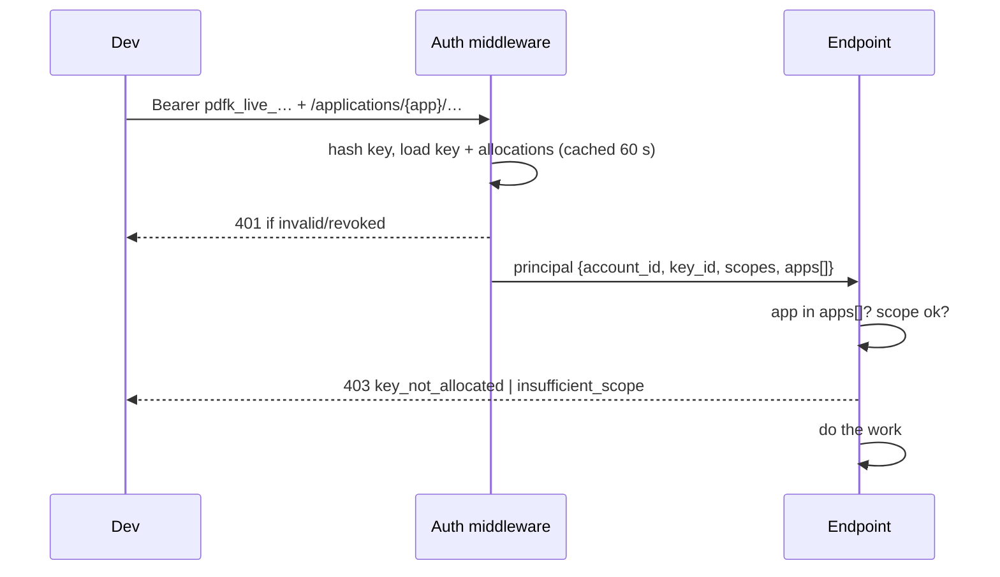

# 01 Accounts, applications and API keys — Design

## Summary
Add four tables (accounts, applications, api_keys, key_applications) and an authentication middleware that resolves
the bearer key to `(account_id, key_id, scopes, allocated_application_ids)` once per request. Endpoints check
allocation before touching data. SQLite now; column types chosen to port to PostgreSQL unchanged.

## Data model
| Entity | Fields | Notes |
|---|---|---|
| accounts | id TEXT(36) PK, name, plan, region, created_at | POC: one seeded account, no signup |
| applications | id TEXT(36) PK, account_id FK, name, is_test INTEGER, created_at, deleted_at | soft delete |
| api_keys | id TEXT(36) PK, account_id FK, name, prefix TEXT(12), hash TEXT(64), scopes TEXT (csv), created_at, last_used_at, revoked_at, previous_hash, previous_valid_until | rotation keeps previous hash |
| key_applications | api_key_id FK, application_id FK, PK(both) | allocation |
| templates (change) | + application_id FK NOT NULL | every template scoped |

## API
| Method | Path | Request | Response | Errors |
|---|---|---|---|---|
| GET | /api/v1/applications | — | `[{id,name,is_test,created_at}]` | 401 |
| POST | /api/v1/applications | `{name,is_test?}` | 201 application | 400 |
| DELETE | /api/v1/applications/{app} | — | 204 | 404, 409 application_not_empty |
| GET | /api/v1/keys | — | keys without secrets, with `applications[]` | 401 |
| POST | /api/v1/keys | `{name,scopes[],applications[]}` | 201 `{…, secret}` | 400 application_not_owned |
| PUT | /api/v1/keys/{key}/applications | `{applications[]}` | 200 key | 400, 404 |
| POST | /api/v1/keys/{key}/rotate | — | 200 `{secret}` | 404 |
| DELETE | /api/v1/keys/{key} | — | 204 | 404 |

POC simplification: portal-session endpoints (`/applications`, `/keys`) are protected by a single admin token from
configuration (`Admin:Token`) until real login exists; API-key endpoints use `Authorization: Bearer pdfk_…`.

## Validation and error codes
| Code | When |
|---|---|
| key_invalid / key_revoked / key_expired | bearer key not found, revoked, or past expiry |
| key_not_allocated | key not allocated to the application in the path or body |
| insufficient_scope | endpoint scope not in key scopes |
| application_not_owned | allocation names an application of another account |
| application_not_empty | delete with templates present |

## Sequence

## Security and tenancy
- Key secret: 32 random bytes, base62, prefix `pdfk_live_`/`pdfk_test_`; stored SHA-256; compared constant-time.
- Every repository method for application-scoped data takes `account_id` and `application_id`.
- Allocation cache invalidated on any key change.

## Testing strategy
- Unit: hashing, scope parsing, allocation check.
- Request-level: each error code above with a seeded account, two applications, two keys.

## Alternatives considered
- JWT-signed keys carrying allocations: rejected, revocation would need a deny-list anyway.
