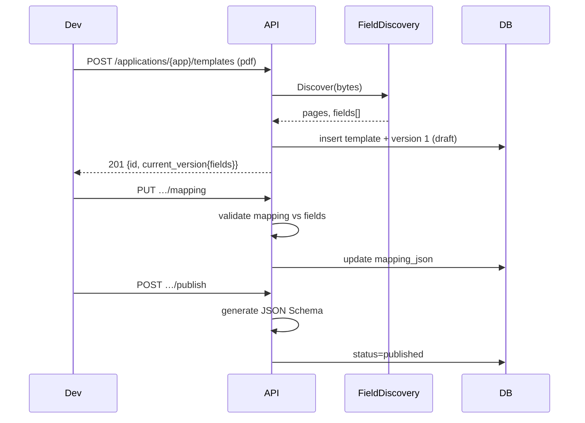

# 02 Templates, versions and mapping — Design

## Summary
Split the POC `templates` table into `templates` + `template_versions`; move field discovery and mapping validation
into `TemplateVersionService`; add publish with JSON Schema generation. The mapping contract and `FieldMapping`
loader stay as they are.

## Data model
| Entity | Fields | Notes |
|---|---|---|
| templates | id TEXT(36) PK, application_id FK, name, tags, current_version_id, created_at, updated_at | |
| template_versions | id TEXT(36) PK, template_id FK, number INTEGER, pdf BLOB, page_count, fields_json, mapping_json, schema_json, status (draft/published/archived), created_at, published_at | UNIQUE(template_id, number) |

## API
| Method | Path | Request | Response | Errors |
|---|---|---|---|---|
| GET | /applications/{app}/templates | — | list with current version summary | 403 |
| POST | /applications/{app}/templates | multipart file, name? | 201 template + version 1 (fields) | 400, 413 |
| GET/PATCH/DELETE | /applications/{app}/templates/{tpl} | | | 404 |
| POST | …/{tpl}/versions | multipart file? | 201 draft version (+ unmapped[]) | |
| GET | …/versions/{ver} | — | fields, mapping, schema, status | |
| GET | …/versions/{ver}/file | — | application/pdf | |
| PUT | …/versions/{ver}/mapping | `{fields}` | 200 version | 400 mapping_invalid, 409 version_published |
| POST | …/versions/{ver}/publish | — | 200 version | 422 mapping_invalid |
| GET | …/versions/{ver}/schema | — | JSON Schema | 404 if draft |

## Validation and error codes
| Code | When |
|---|---|
| mapping_field_missing | entry names a field id not in the PDF |
| mapping_type_mismatch | entry type disagrees with the PDF field type |
| mapping_table_pattern | table column pattern does not resolve for a row |
| version_published | write attempted on a published version |
| template_not_in_application | template id not under the application in the path |

## Sequence

## Security and tenancy
- Template id is resolved with `application_id` in the WHERE clause; a mismatch is 404 `template_not_in_application`.
- Uploads parsed in a bounded task (10 s, 512 MB) and rejected on timeout with 422.

## Testing strategy
- Unit: mapping validation cases, schema generation from the sample mapping.
- Request-level: upload → map → publish → schema; 409 after publish; version 2 with renamed field.

## Alternatives considered
- Storing PDFs on disk in the POC: rejected, BLOB keeps the POC single-file and the production path is object storage anyway.
