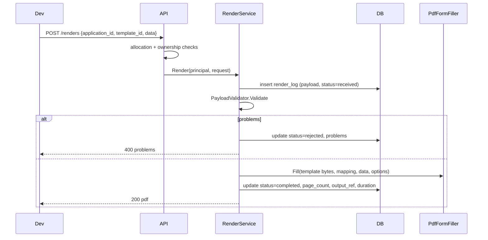

# 03 Render and render log — Design

## Summary
Replace `POST /api/v1/templates/{id}/render` with `POST /api/v1/renders` that takes ids in the body; wrap the existing
`PayloadValidator` + `PdfFormFiller` in `RenderService`, which writes the render_log row first, then renders, then
updates the row. Reading the log is a paged query per application.

## Data model
| Entity | Fields | Notes |
|---|---|---|
| render_log | id TEXT(36) PK, account_id, application_id, template_id, version_id, version_number, api_key_id, request_id, payload TEXT(json), options TEXT(json), status, problems TEXT(json), page_count, output_ref, duration_ms, created_at, completed_at, payload_purged_at | index (application_id, created_at DESC); index (template_id, created_at) |
| applications (change) | + retention_days INTEGER DEFAULT 90 | |

## API
| Method | Path | Request | Response | Errors |
|---|---|---|---|---|
| POST | /api/v1/renders | `{application_id, template_id, version?, data, options?, metadata?}` | 200 application/pdf (+X-Render-Id, X-Page-Count) or 200 JSON with `Accept: application/json` | 400 problems, 403 key_not_allocated, 404 template_not_in_application, 409 version_not_published |
| GET | /api/v1/renders/{id} | — | row incl. payload | 403, 404 |
| GET | /api/v1/renders/{id}/file | — | application/pdf while retained | 404, 410 |
| GET | /api/v1/applications/{app}/renders?status&template_id&from&to&limit&cursor | — | `{items[], next_cursor}` | 403 |
| POST | /api/v1/applications/{app}/templates/{tpl}/versions/{ver}/validate | `{data, strict}` | `{valid, problems}` | 403 |

## Validation and error codes
Existing payload codes unchanged. New: `version_not_published`, `template_not_in_application`, `key_not_allocated`, `render_failed` (in the log only).

## Sequence

## Rate limiting
Already implemented (`Services/RateLimiting.cs`): `render` policy on `POST /renders` and `/validate`, `api` policy elsewhere, partition = API key hash. Production: move to the gateway or Redis-backed limiter so limits hold across instances.

## Security and tenancy
- `application_id` from the body is checked against the principal's allocations before the template is loaded.
- `GET /renders/{id}` loads the row by id and then re-checks allocation against the row's application_id.
- Payload column encrypted at rest in production (application-level AES with the account key); POC stores plain JSON with a TODO in code.
- Retention job (hosted service, hourly) nulls `payload` and `output_ref`, sets `payload_purged_at`.

## Testing strategy
- Unit: existing PayloadValidatorTests; RenderService writes row before validation (fake repository).
- Request-level: 200 flow, each 4xx, log listing order and filters, retention job.

## Alternatives considered
- Logging only a hash of the payload: rejected by requirement (reproducibility).
